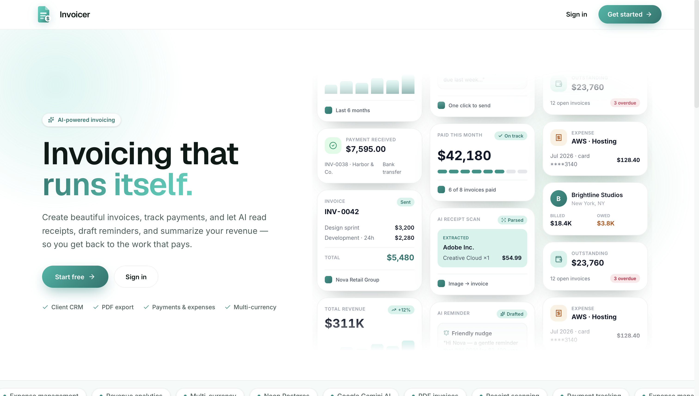
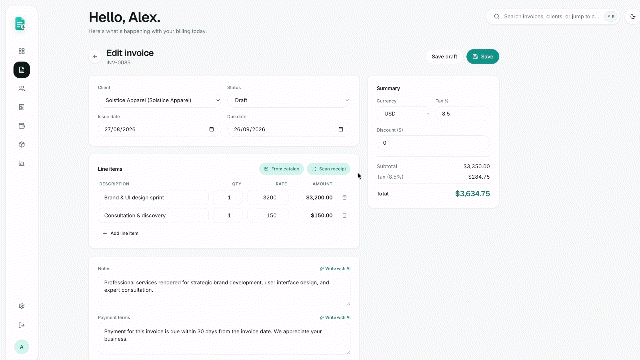
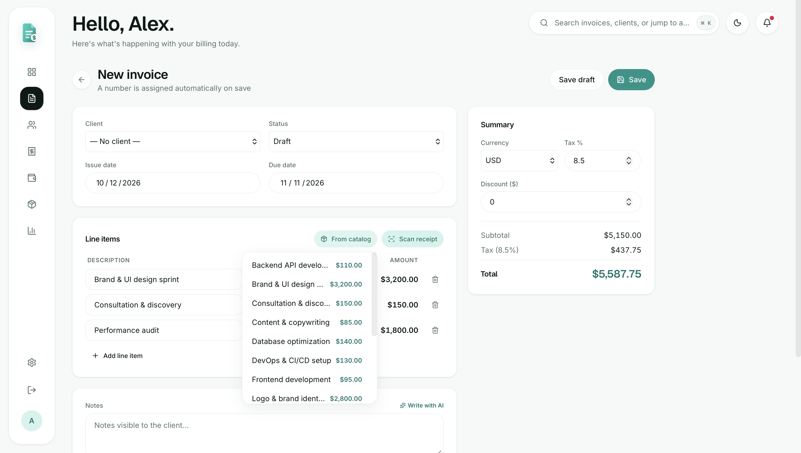
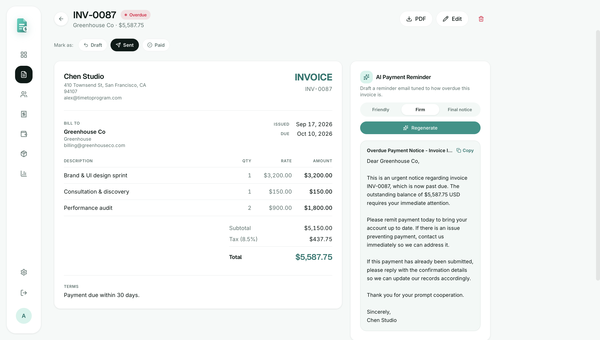
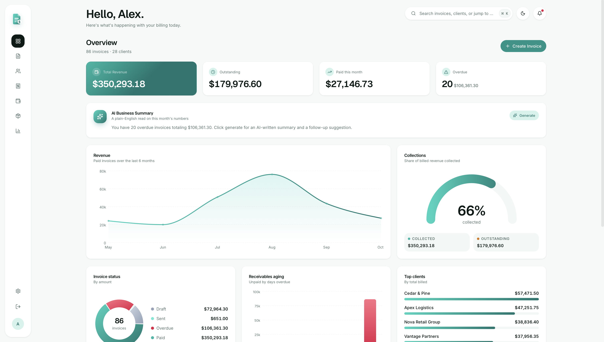
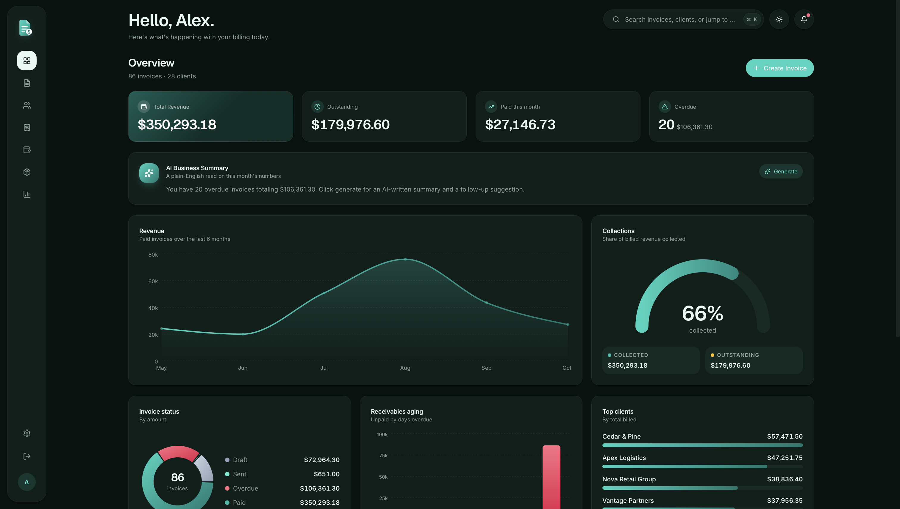
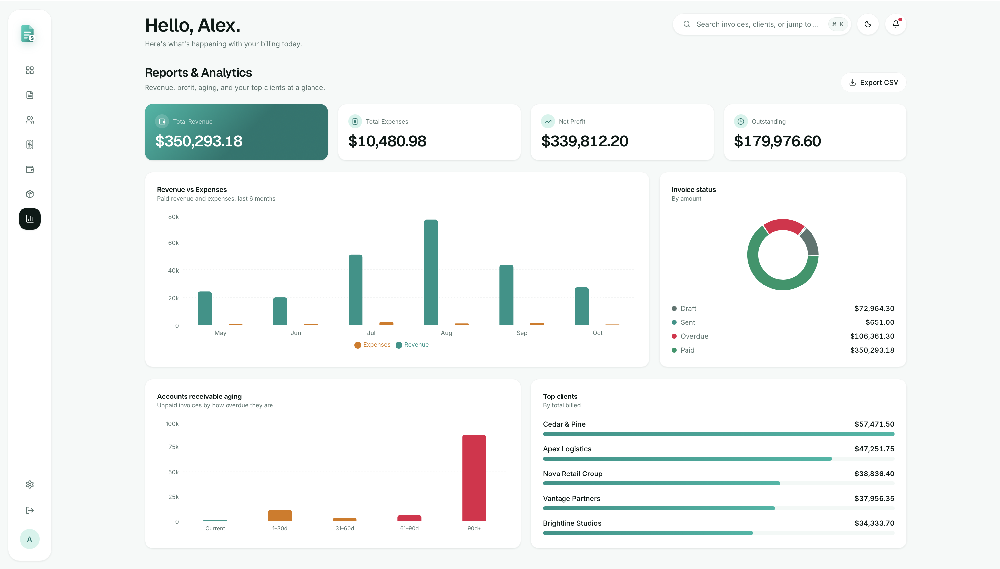

# Invoicer — AI-Powered Invoicing & Billing

> Invoicing that runs itself. Snap a photo of a receipt and the AI fills in your invoice, writes your payment reminders, and summarizes your month in plain English.




## Overview

Invoicer is a full-stack billing app with AI built into the tedious parts of invoicing. Underneath the AI, it is a complete billing system: a client CRM, invoices with a live line-item builder and PDF export, self-reconciling payments, expense tracking, a services catalog, and an analytics dashboard.

**My contribution:** I built the entire backend from scratch (REST API, PostgreSQL schema, cookie-based authentication, business logic, and the Gemini integration), then connected it to a provided React frontend by replacing its mock data layer with real API calls.

## AI Features

- **Receipt scanning:** upload a photo or PDF and Gemini's vision model extracts the vendor, date, and every line item to pre-fill an invoice or expense
- **Business summary:** a plain-English read on your month, with a specific follow-up suggestion
- **Payment reminders:** friendly, firm, or final-notice emails tuned to how overdue the invoice is
- **Write with AI:** drafts service descriptions and payment-terms notes

## Engineering Highlights

- **Secure sessions:** JWT in an HTTP-only cookie, bcrypt-hashed passwords, and a `user_id` filter on every query so users can never reach each other's data
- **Server-side money math:** clients send only description, quantity, and rate, and the server computes every total, so a tampered request can't change what an invoice adds up to
- **Transactions where it counts:** invoices save atomically with their line items, and recording a payment updates the invoice status in the same transaction, so invoices flip to paid (and back) automatically
- **Analytics in SQL:** the dashboard and reports use aggregate queries, `generate_series` for gap-free monthly trends, and a receivables aging report bucketed by days overdue
- **Grounded AI:** the database does the arithmetic and Gemini only turns accurate facts into readable language, and receipt parsing uses a strict JSON response schema validated with Zod
- **Production habits:** centralized error handling, Zod validation on every request, rate limiting on AI and auth endpoints, and an idempotent seed script for realistic demo data

## Tech Stack

| Layer | Technology |
| --- | --- |
| **Frontend** | React 19, Vite, Tailwind CSS v4, React Query, React Router 7, Framer Motion, Recharts, @react-pdf/renderer |
| **Backend** | Node.js, Express 5 |
| **Database** | PostgreSQL on Neon |
| **AI** | Google Gemini |
| **Validation & security** | Zod, JWT, bcrypt, express-rate-limit |

## Screenshots



| Invoice builder | AI payment reminder |
| --- | --- |
|  |  |

| Dashboard (light) | Dashboard (dark) |
| --- | --- |
|  |  |



More screenshots are in the [full documentation](docs/DOCUMENTATION.md#screenshots).

## Quick Start

You need Node.js 20+, a [Neon](https://neon.tech) Postgres database, and a [Gemini API key](https://aistudio.google.com/apikey).

```bash
git clone https://github.com/coderbri/ai-invoice-manager.git
cd ai-invoice-manager

# Backend: create backend/.env first (DATABASE_URL, JWT_SECRET, GEMINI_API_KEY)
cd backend && npm install
npm run seed      # creates the demo account and its data
npm run dev       # API on http://localhost:8000

# Frontend, in a second terminal
cd frontend && npm install
npm run dev       # app on http://localhost:5173
```

Sign in with the demo account (or use the **Use demo credentials** button on the login page):

| Email | Password |
| --- | --- |
| `alex@timetoprogram.com` | `Test@1234` |

See the [full documentation](docs/DOCUMENTATION.md#environment-variables) for every environment variable.

## Learn More

- **[Full documentation](docs/DOCUMENTATION.md):** complete feature list, setup guide, environment variables, API reference, database schema, security details, and project structure
- **[CHANGELOG.md](CHANGELOG.md):** what shipped in each version
- **[NOTES.md](docs/NOTES.md):** build notes with the logic behind each stage and lessons learned

## Acknowledgments

Built as a guided tutorial project. Tutorial credit: [Full-Stack AI Invoicing & Billing App Tutorial | React, Node.js, Postgres & Google Gemini](https://youtu.be/FrRSqYYzBlk?si=UyNk68Um664ud508) | Time to Program.

## License

Released under the [MIT License](LICENSE). The frontend UI boilerplate comes from the tutorial credited above and is not covered by this license.